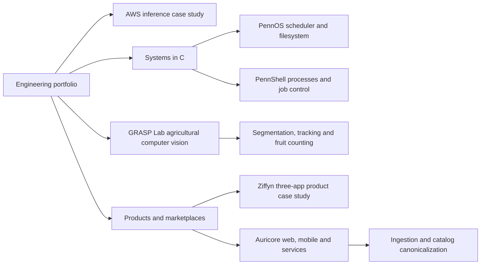

# Jai Ashar

I'm the cofounder of **[Vora](https://askvora.com)**. Previously, I built machine-learning inference infrastructure at **AWS**, working on **Amazon SageMaker and Amazon Bedrock**. I also worked on computer-vision models and fruit-counting research at Penn's **[GRASP Lab](https://www.grasp.upenn.edu/)**. My work spans consumer products, machine learning, and systems programming.

## Vora · A proactive personal health AI agent

We're building Vora to investigate what's affecting your health and progress, start conversations before you know what to ask, and follow up as you make changes. The agent will bring together wearables, blood work, meals, supplements, and health history, explain what it notices, ask for missing context, and help you decide what to change.

Our iOS and Android apps are live. We've built a connected health-data foundation through partnerships and integrations, along with proactive AI, knowledge graphs, and algorithms for identifying trends and relationships in that data. We're now developing the primary experience around **text and voice through iMessage, WhatsApp, and calls**, with explanations, graphs, recommendations, and follow-ups in the conversation.

[Explore Vora](https://askvora.com) · [iOS app](https://apps.apple.com/us/app/vora-health/id6754351240)

## AWS · Machine-learning inference infrastructure

At AWS, I built infrastructure for **SageMaker and Bedrock**, including asynchronous model hosting for long-running workloads. I also worked directly with enterprise customers to develop, train, and optimize models using **PyTorch and Hugging Face**, working through tradeoffs in model quality, training time, memory requirements, and inference cost.

| Work | Capability | Public reference |
| --- | --- | --- |
| **SageMaker inference** | Host multiple foundation models on shared endpoints with per-model resource allocation and independent scaling | [Launch announcement](https://aws.amazon.com/blogs/aws/amazon-sagemaker-adds-new-inference-capabilities-to-help-reduce-foundation-model-deployment-costs-and-latency/) |
| **Bedrock asynchronous invocation** | Start model work asynchronously and track the invocation separately from the initial request | [StartAsyncInvoke API](https://docs.aws.amazon.com/bedrock/latest/APIReference/API_runtime_StartAsyncInvoke.html) |

[Engineering case study](https://github.com/Jaiashar/aws-inference)

## GRASP Lab · Computer vision and fruit counting

At the University of Pennsylvania's **[GRASP Lab](https://www.grasp.upenn.edu/)**, I worked on **computer-vision models and fruit-counting research**. The agricultural vision work represented in [Tréfo](https://github.com/Trefo) spans image annotation, TensorFlow segmentation, and tracking fruit across image sequences to support counting and crop analysis.

The research code includes VGG-based fully convolutional networks, optical flow, Kalman filtering, and Hungarian assignment for associating detections across frames. The technical walkthrough explains the team architecture, the counting logic, and the implementation status of the mobile/API prototype.

[Research and architecture walkthrough](research-and-systems.md) · [Public AgDSS annotation code](https://github.com/Trefo/agdss)

## Technical reading map

For implementation depth, start with [PennOS](https://github.com/Jaiashar/penn-os) and its scheduler/filesystem walkthrough, then [PennShell](https://github.com/Jaiashar/penn-shell) for process and terminal control. For application architecture, follow [Auricore Web](https://github.com/Jaiashar/auricore-web) into the mobile, service, and data repositories. AWS and Ziffyn are explicitly labeled case studies; their original implementation source is not included.

## Selected builds

### [PennOS · An operating system in C](https://github.com/Jaiashar/penn-os)

I built a Unix-like operating system as part of a Penn team project: **preemptive scheduling, process management, a shell, and a FAT-style filesystem**. It switches execution contexts, manages process priorities and state, handles signals, and reads and writes files through PennFAT. The instructional OS runs in Linux userspace using timer signals and `ucontext`.

[Source and architecture](https://github.com/Jaiashar/penn-os) · [Build and validation](https://github.com/Jaiashar/penn-os/blob/main/VALIDATION.md)

### [Ziffyn · Home-chef marketplace](https://github.com/Jaiashar/ziffyn)

We built Ziffyn around the opportunity created by California's **Microenterprise Home Kitchen Operation (MEHKO)** framework: helping home chefs turn their cooking into a food business. We recruited **hundreds of chefs**, and I taught myself iOS to build **three connected applications: a consumer app, marketplace app, and chef/driver app**. The work combined building chef supply with implementing the customer and provider sides of the service.

[Business premise, application architecture, and source status](https://github.com/Jaiashar/ziffyn) · Case study; original app source has not yet been located for publication.

### [Auricore · Identify and price luxury goods](https://github.com/Jaiashar/auricore-web)

Auricore helps answer **“What is this item, and what is it worth?”** A user starts with a photo or a manual description; the application identifies the item, finds comparable listings, and presents market-price research. The broader product includes inventory, mobile item intake, and borrower/lender application flows.

I contributed across the web and mobile applications and built product-data pipelines behind the catalog. The public code covers the user experience and the work of collecting, structuring, and matching inconsistent listings across marketplaces.

| Component | What it does |
| --- | --- |
| [Web application](https://github.com/Jaiashar/auricore-web) | Photo identification, comparable-listing research, valuation results and application intake |
| [Mobile application](https://github.com/Jaiashar/auricore-mobile) | Guided item intake, inventory, category-specific AI conversations and payment onboarding |
| [Product ingestion](https://github.com/Jaiashar/luxury-product-ingestion) | Multi-site listing collection, AI categorization, image processing and catalog storage |
| [Product canonicalization](https://github.com/Jaiashar/product-canonicalization) | Product matching, attribute extraction, enrichment and duplicate review |
| [Supporting services](https://github.com/Jaiashar/auricore-services) | API, payments and shared transaction types |

These are documented historical source snapshots with collaborator credits and validation notes.

### [PennShell · A Unix shell in C](https://github.com/Jaiashar/penn-shell)

A shell with **pipelines, I/O redirection, process groups, signal handling, and foreground/background jobs**. Mytreyi Narayanaswamy and I pair-programmed it, contributing roughly equally. It implements the process and terminal control behind commands such as `printf hello | wc -c`, `jobs`, `bg` and `fg`.

[Source, build instructions and examples](https://github.com/Jaiashar/penn-shell)

### Fine-wine traceability · Blockchain and IoT

I architected and developed an operational supply-chain platform connecting a custom blockchain network API with IoT trackers monitoring **temperature, humidity, and light exposure from vineyard to cellar**. It gave consumers, investors, distributors, and auction houses a shared way to verify wine provenance and storage conditions.

## Other research and systems work

My [research notes](research-and-systems.md#open-uav-drone-simulation) also cover Open-UAV drone simulation, a virtual-memory project, and the broader Auricore team's analytics and pricing systems.
