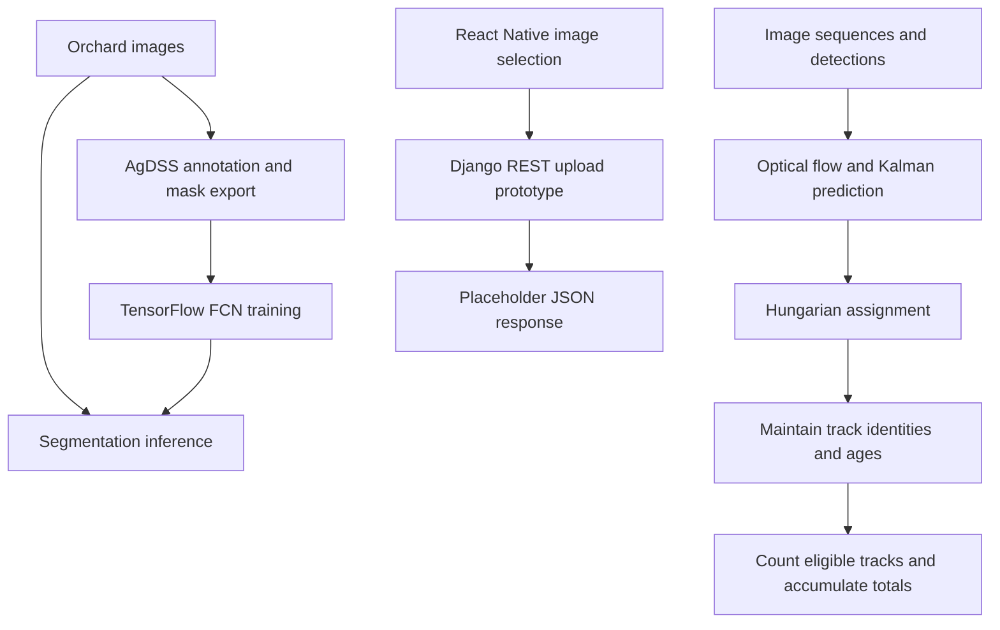
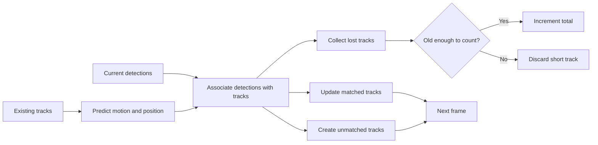

# Jai Ashar · GRASP Lab computer vision and research

I worked on **computer-vision models and fruit-counting research at the University of Pennsylvania's [GRASP Lab](https://www.grasp.upenn.edu/)**. This page explains the agricultural vision work represented in [Tréfo](https://github.com/Trefo), followed by other research and systems projects.

My contribution was to the computer-vision and fruit-counting research. The architecture below describes the broader team's implementation, including supporting annotation, tracking, and mobile components. Original repositories retain their contributors and upstream model credits.

## Agricultural vision: from images to counts

Counting fruit in orchard imagery requires more than recognizing a fruit in one photograph. Leaves can obscure it, neighboring fruit can overlap, and camera motion can make the same fruit appear in many consecutive frames. The research combines image labeling, pixel-level segmentation, and tracking to turn observations into useful counts.

The repository contains several research components. This diagram summarizes their roles; it does not imply that every component is connected in a complete deployed application.

### Segmentation models

The agricultural model code uses **TensorFlow 1.x** and a **VGG-19-initialized fully convolutional network**. It produces a class prediction for each pixel rather than one label for an entire image. The inspected agricultural variant uses two output classes.

The network subtracts the model's mean pixel values, extracts convolutional features, and combines coarse predictions with intermediate features through skip connections. Transposed convolutions restore spatial resolution, and an `argmax` over output logits produces the segmentation mask. The training implementation uses sparse softmax cross-entropy and Adam; inference restores saved checkpoints.

The public [Tréfo FCN repository](https://github.com/Trefo/FCN.tensorflow) documents the upstream implementation and research it builds on. It is a general segmentation codebase; the agricultural adaptations are in the separate research repository.

### Tracking and counting

The tracking implementation uses **OpenCV optical flow, Kalman filtering, and Hungarian assignment**. Optical flow estimates image motion, the filter maintains track state, and assignment associates new detections with existing tracks. Track identities let the system reason about repeated observations of the same object.

The inspected counting implementation applies a minimum track-age threshold. It counts eligible tracks when they leave the active set and handles remaining tracks at the end of the sequence. It also retains bounding-box and position information for localization work. Some variants were adapted for trunk tracking, so their parameters should not be treated as universal fruit-counting settings.

### Annotation and mobile tooling

[AgDSS](https://github.com/Trefo/agdss) provides a Django-based image-annotation workflow with category labels, image filtering, and SVG/mask export. This is the strongest public source entry point for the research's annotation tooling.

The related mobile prototype uses React Native's image picker to send a base64 image to a Django REST endpoint. In the inspected snapshot, the endpoint decodes the image and returns placeholder JSON. Model code is present alongside it, but the request handler does not run inference or return a fruit count. The mobile component is an integration prototype.

## Source guide and reproducibility

| Component | Implementation to inspect | Availability |
| --- | --- | --- |
| Image annotation | AgDSS Django application and `webclient` | [Public repository](https://github.com/Trefo/agdss) |
| General FCN implementation | TensorFlow segmentation with upstream references | [Public repository](https://github.com/Trefo/FCN.tensorflow) |
| Agricultural segmentation | `FCN_Segmentation/FCNInference.py` | Original Tréfo research repository, currently private |
| Tracking and counting | `scpye/track/fruit_tracker.py` and related tracking modules | Original Tréfo research repository, currently private |
| Mobile upload prototype | `agdss_mobile/ag_ui/App.js` and `fruit_count/views.py` | Original Tréfo research repository, currently private |

The research snapshot includes legacy Python 2 and TensorFlow dependencies, datasets, and serialized outputs. This walkthrough is based on source inspection; it does not claim a reproduced training run or a measured accuracy result. Dataset and checkpoint availability would need to be established before providing a reproducible model evaluation.

## Open-UAV: drone simulation

[Open-UAV](https://github.com/Open-UAV) works with PX4, ROS and Gazebo for drone simulation, including multi-vehicle examples and browser-accessible simulation infrastructure. My recorded code contributions include UAV-count configuration changes for multi-vehicle examples. The simulator, firmware and robotics components retain their original team and upstream credit.

## Virtual memory

The Penn CIS 548 group-project collection also includes a virtual-memory implementation with allocation/free, page tables, a TLB, swapping, and FIFO/LRU/Clock page-replacement policies. It remains in the original course repository while the implementation and teaching framework are separated for a public presentation.

For public systems source with build instructions, see [PennOS](https://github.com/Jaiashar/penn-os) and [PennShell](https://github.com/Jaiashar/penn-shell).

## Auricore analytics and pricing models

The broader Auricore team developed a pricing-model pipeline, a React/D3 analytics dashboard and product/transaction APIs. Those components complement the item-identification and product-data work in my public repositories. Their recorded implementation history includes collaborators, and they remain credited team work rather than being republished here under my sole authorship.
